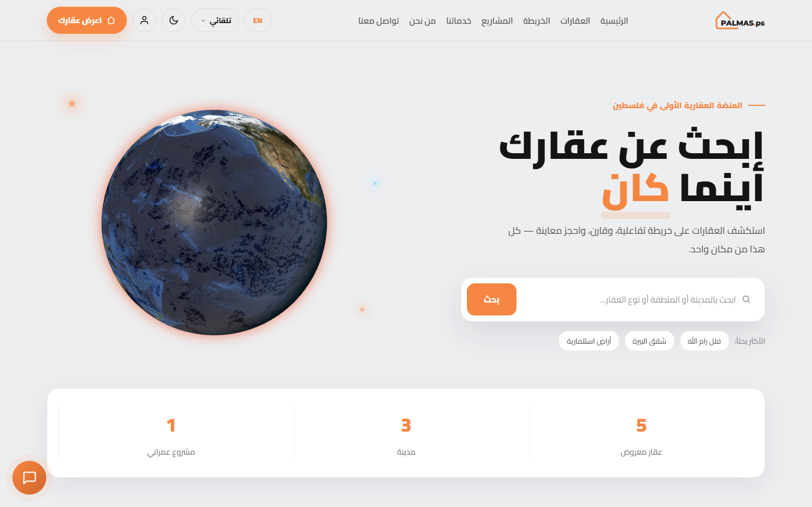
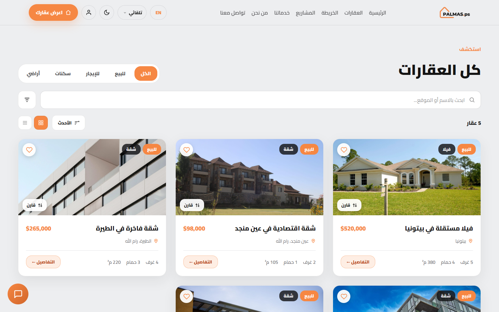
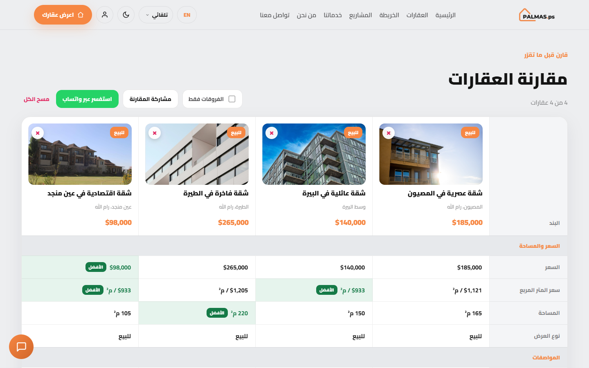
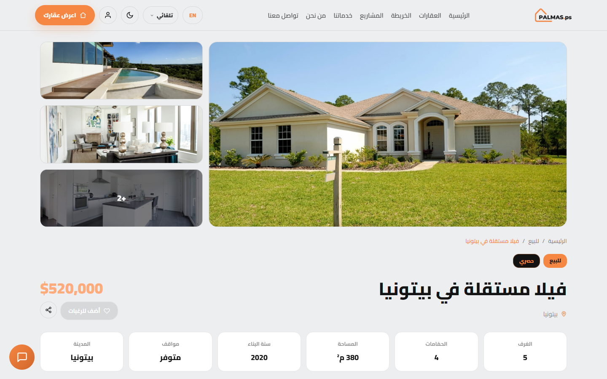
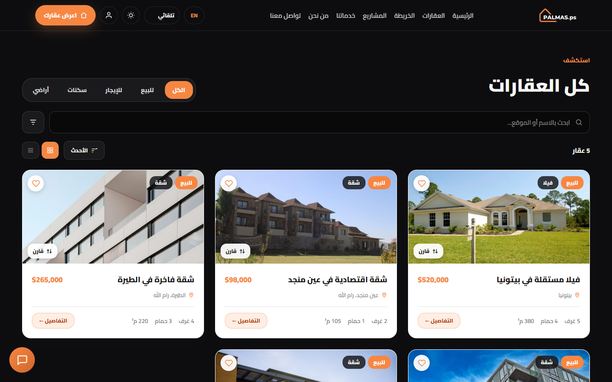
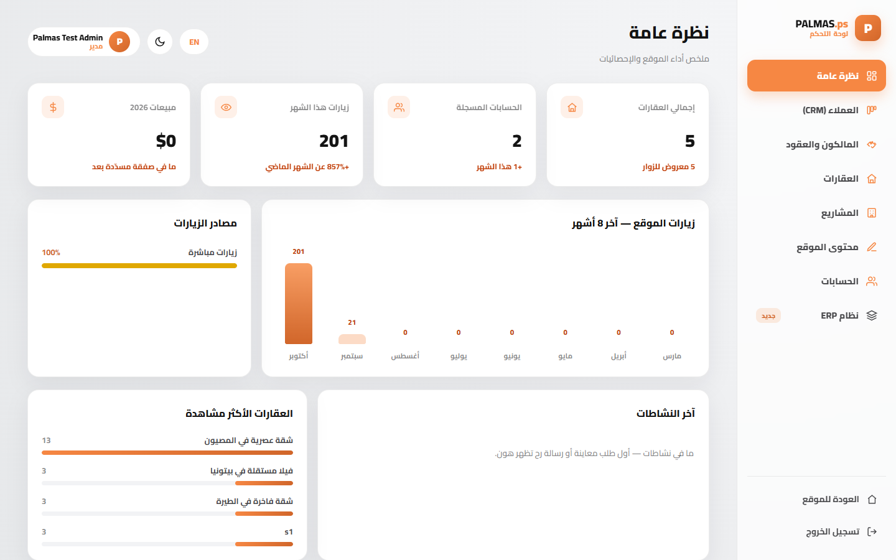
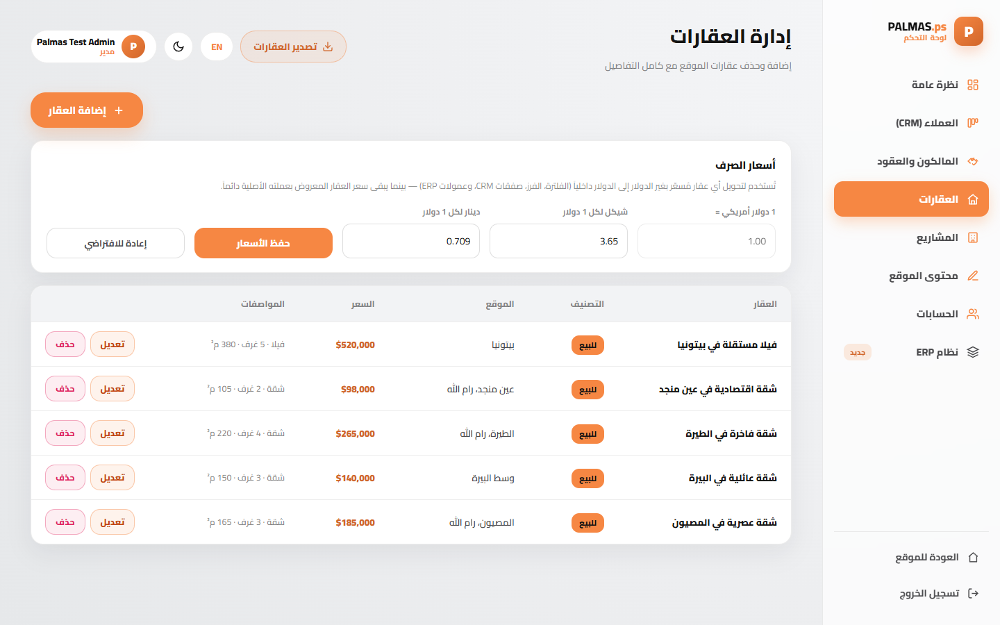
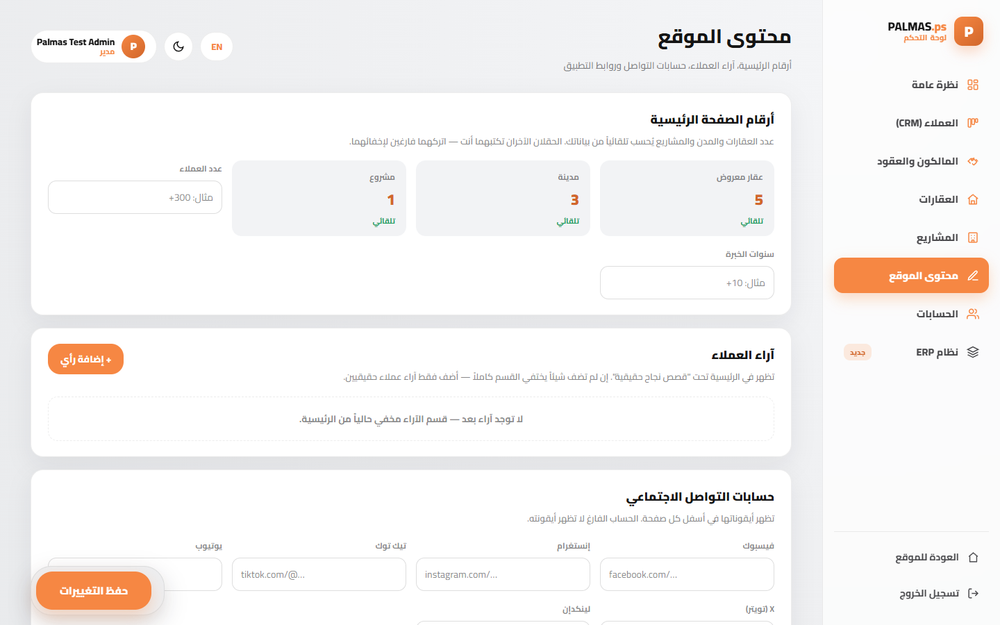
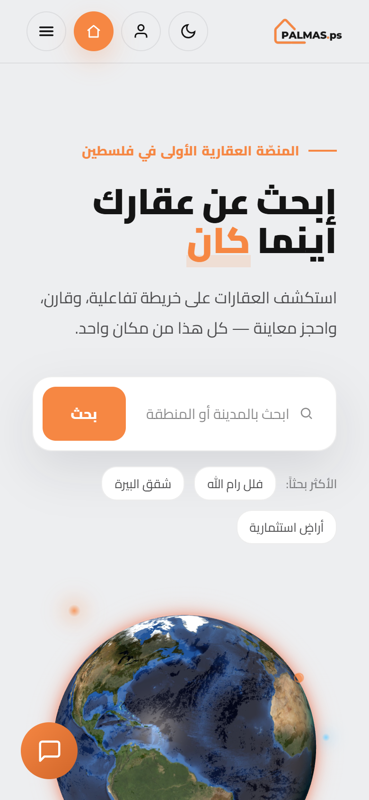
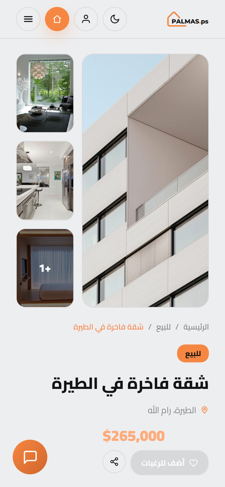

<p align="center">
  
</p>

<h3 align="center">A real-estate brokerage platform for Palestine — website, admin panel, CRM/ERP and mobile app on one backend</h3>

<p align="center">
  <a href="https://aboodmasri2.github.io/palmas-real-estate/"><b>Live demo</b></a> ·
  <a href="#the-business-behind-the-build">Business</a> ·
  <a href="#features">Features</a> ·
  <a href="#architecture">Architecture</a> ·
  <a href="#run-it-locally">Run locally</a> ·
  <a href="#بالعربي">بالعربي</a>
</p>

> 🚧 **Status: in active development.** The core platform is live and working end to end —
> see the [roadmap](#roadmap) for what's next.



## What it is

Palmas.ps is a brokerage, not a classifieds board: owners and companies hand their properties
to the office under a brokerage contract, the office publishes them, and buyers and tenants
contact the office — never the owner directly. The platform covers that whole cycle:

**owner submits a listing → admin signs an owner contract → property goes live with photos →
visitor books a viewing or chats → lead lands in the CRM → deal closes → commission and invoice in the ERP.**

Fully bilingual (Arabic RTL / English LTR), light and dark themes, multi-currency (USD / ILS / JOD),
and responsive down to small phones.

## The business behind the build

I'm an **MIS graduate**, and this project is where management and technology meet: I started from
how a brokerage office actually makes money and works day to day, then designed the system around it.

| Business question | How the platform answers it |
|---|---|
| Where does revenue come from? | Brokerage **contracts with commission rates**, expected vs. realized commission, contracts expiring within 14 days flagged for renewal |
| How do we turn visitors into deals? | One **sales funnel**: every booking, message, chat and listing request becomes a lead in the CRM pipeline (new → contacted → viewing → negotiation → won / lost) |
| How do we win more supply? | A "list your property" flow for owners and companies feeding straight into owner management |
| Is the marketing working? | Real **KPIs** — monthly visits, traffic sources, most-viewed listings, pipeline value, revenue split by sale / rent |
| Can the office run without a developer? | Every piece of site content, listing, photo and currency rate is managed from the admin panel |
| How do buyers decide faster? | Side-by-side **comparison** with best-value highlights and a one-tap WhatsApp inquiry to sales |

The focus throughout is **business development and sales**: shorten the path from first visit to
signed deal, keep every lead visible to the team, and give management numbers they can act on.

## Features

### Public website
- **Search & filters** — city, type, offer (sale / rent / land), price, rooms, area; grid and list views, sorting
- **Property comparison** — up to 4 properties side by side, best value per row highlighted,
  "differences only" toggle, shareable link, WhatsApp inquiry
- **Interactive map** of all listings
- **Property and project pages** — photo gallery with lightbox, specs, features, viewing booking
- **Live chat widget** that captures the visitor's name and phone and delivers the conversation to the CRM
- **"List your property"** form for owners, wishlist, user accounts
- Home page content (stats, testimonials, social links, app-store links) is **driven by the admin panel** —
  sections with no real data hide themselves instead of showing placeholders

### Admin panel
- **Dashboard** with real visit analytics (monthly visits, traffic sources, most viewed properties)
- **Properties & projects** — full CRUD, photo upload straight onto the page (click any image slot)
- **CRM** — pipeline stages, contacts, inbox (bookings, messages, chats, listing requests), appointments, tasks
- **Owners & contracts** — brokerage contracts with commission, mandate period, and expiry alerts
- **ERP** — deals, invoices, expenses, staff, revenue split by sale / rent
- **Site content** editor and **currency rates**

### Mobile app (React Native + Expo)
Android and iOS app on the **same database and the same business logic** as the website:
listings, filters, map, property pages, wishlist, accounts, bookings.

## Screenshots

| Listings | Comparison |
|---|---|
|  |  |

| Property page | Dark theme |
|---|---|
|  |  |

| Admin dashboard | Admin — properties |
|---|---|
|  |  |

| Admin — site content | Mobile |
|---|---|
|  |   |

## Architecture

```
            ┌──────────────────────────┐        ┌──────────────────────────┐
            │  Website (HTML/JS pages) │        │  Mobile app (Expo / RN)  │
            └────────────┬─────────────┘        └────────────┬─────────────┘
                         │      shared business logic         │
                         └──────────► palmas-core.js ◄────────┘
                                 (filters, currency, compare,
                                  CRM/ERP models — no DOM)
                         ┌───────────────┴────────────────┐
                palmas-backend.js                  palmas-api.js
                 (website bridge)                    (app bridge)
                         └───────────────┬────────────────┘
                                         ▼
                 Supabase — Postgres · Auth · Storage · Row Level Security
```

- **One core, two clients.** `palmas-core.js` is plain JavaScript with no browser dependencies, so the
  website and the React Native app run the *same file* — filtering, pricing, currency conversion and
  comparison can't drift between them.
- **Security lives in the database.** Every table has RLS policies; admin rights come from
  `public.is_admin()`. Visitors can *insert* bookings, messages and chats but can never read them back.
  Owner contracts and invoices are admin-only. Only the publishable key is in the client.
- **No fake data.** Statistics, testimonials and analytics come from real rows; empty sections hide.

| Layer | Tech |
|---|---|
| Website | HTML, CSS, JavaScript, React-based component pages (`.dc.html`), Leaflet |
| Mobile | React Native 0.86, Expo SDK 57, React Navigation, react-native-maps |
| Backend | Supabase: PostgreSQL, Auth, Storage, RLS policies |
| Hosting | GitHub Pages (website) · EAS Build (app) |

## Roadmap

**Done** ✅ — website, admin panel, CRM, ERP, owners & contracts, property comparison,
live chat to CRM, real analytics, mobile app connected to the same backend.

**Next phases**
1. **AI sales assistant** in the website chat — answers property questions and qualifies leads for the sales team
2. **Mobile app release** on Google Play and the App Store
3. **Official launch** on the Palmas.ps domain with real listings from partner owners and companies

**Planned improvements**
- Sales reports export (PDF / Excel) and monthly performance summaries for management
- Automated follow-ups: viewing reminders and contract-renewal alerts by WhatsApp / email
- Google sign-in and full Google Maps support on Android
- Smarter search suggestions based on what visitors actually search for
- Arabic Cairo font in the mobile app to match the website

## Repository layout

```
Palmas.ps عقارات/     the website: public pages, admin panel, CRM, ERP
  palmas-core.js      shared business logic (also used by the app)
  palmas-backend.js   connects the website to Supabase
PalmasApp/            the mobile app (React Native + Expo)
palmas-backend/       database schema, RLS policies, app data layer
docs/screenshots/
```

## Run it locally

**Website** — any static server from the site folder:

```bash
cd "Palmas.ps عقارات"
python -m http.server 5500
# open http://localhost:5500/
```

**Mobile app**

```bash
cd PalmasApp
npm install
npx expo start      # scan the QR code with Expo Go
```

**Your own backend** — create a Supabase project and run the SQL files in order;
see [palmas-backend/README.md](palmas-backend/README.md).

---

## بالعربي

**بالماس (Palmas.ps)** منصّة وساطة عقارية متكاملة لفلسطين: موقع، لوحة إدارة، CRM و ERP، وتطبيق جوال —
كلها على قاعدة بيانات واحدة.

> 🚧 **الحالة: قيد التطوير.** المنصّة الأساسية شغّالة بالكامل.

**المراحل الجاية:** مساعد مبيعات ذكي بالشات · نشر التطبيق على Google Play و App Store · الإطلاق الرسمي على دومين Palmas.ps

**تحسينات مخطّطة:** تصدير تقارير المبيعات (PDF / Excel) · تذكيرات تلقائية للمعاينات وتجديد العقود عبر واتساب والإيميل ·
تسجيل الدخول بـ Google · اقتراحات بحث أذكى · خط Cairo بالتطبيق

المالك أو الشركة بيسلّموا العقار للمكتب بعقد وساطة، المكتب بينشره، والزبون بيتواصل مع المكتب.
المنصّة بتغطّي الدورة كاملة: طلب عرض عقار ← عقد مع المالك ← نشر العقار بالصور ← حجز معاينة أو محادثة ←
العميل بيوصل للـ CRM ← إغلاق الصفقة ← العمولة والفاتورة بالـ ERP.

- **الموقع:** بحث وفلاتر، **مقارنة حتى 4 عقارات**، خريطة تفاعلية، صفحات عقارات ومشاريع، شات حيّ، عربي/إنجليزي، فاتح/داكن، 3 عملات
- **لوحة الإدارة:** إحصاءات حقيقية، إدارة العقارات والمشاريع والصور، CRM، المالكون والعقود، ERP، تعديل محتوى الموقع
- **التطبيق:** أندرويد و iOS بنفس البيانات ونفس المنطق
- **الأمان:** صلاحيات على مستوى قاعدة البيانات (RLS) — الزائر بيرسل وما بيقرأ، وبيانات المالكين والفواتير للأدمن بس

**الجانب الإداري:** أنا خريج **نظم معلومات إدارية (MIS)**، والمشروع بيجمع بين الإدارة والتقنية.
بلّشت من سؤال: كيف مكتب الوساطة بيربح وكيف بيشتغل يومياً؟ وبنيت النظام حوالين الجواب —
عقود وعمولات، مسار مبيعات واحد لكل العملاء، مؤشرات أداء حقيقية للإدارة، ولوحة تحكم بتخلّي المكتب
يدير كل المحتوى بدون مبرمج. التركيز كله على **تطوير الأعمال والمبيعات**: أقصر طريق من أول زيارة لعقد موقّع.

---

## About me

**Abood Masri** — MIS graduate working where business and technology meet: business development,
sales operations, CRM/ERP processes, and building the digital tools that support them.

I owned this project end to end — the business model, the brokerage workflow, the data model,
the feature priorities and the testing — and built it with AI-assisted development tools for
design and code.
